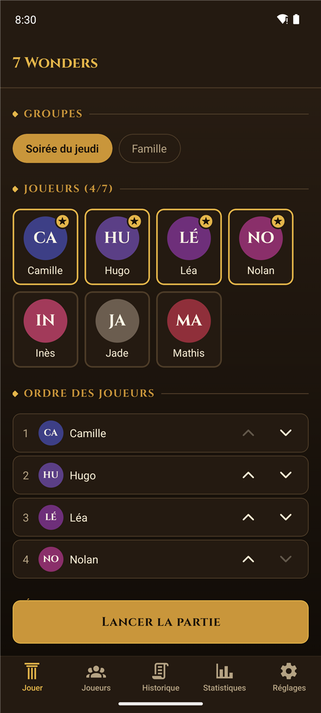
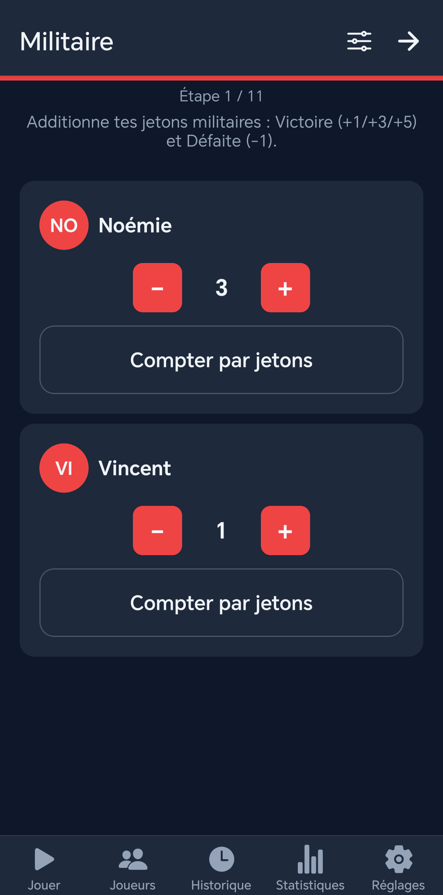
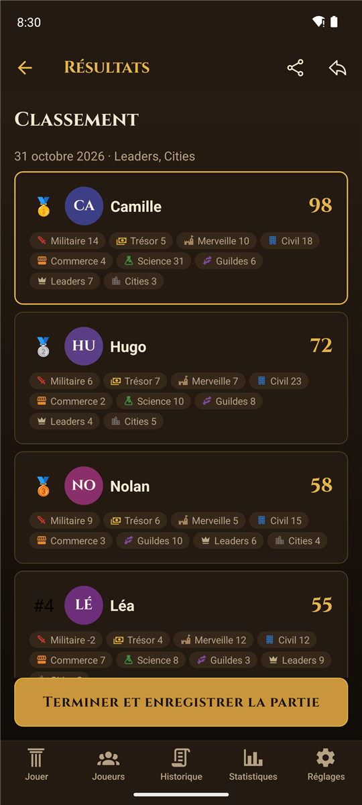
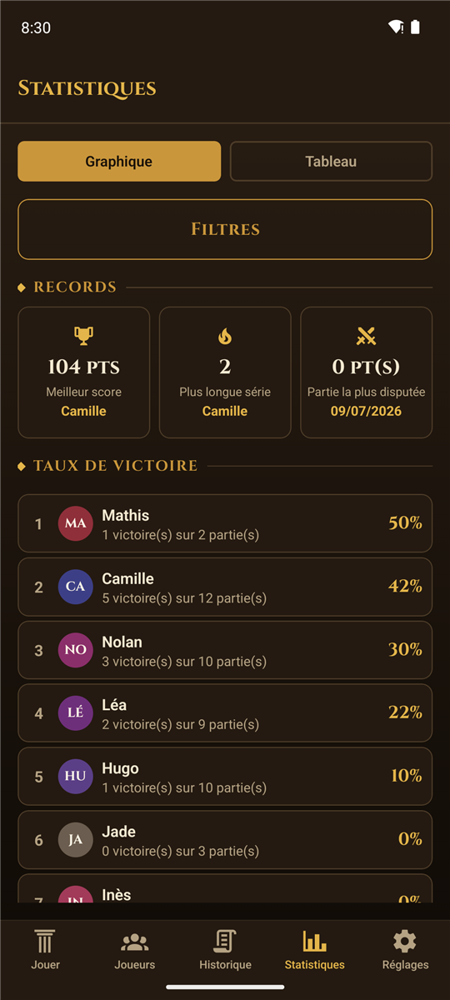
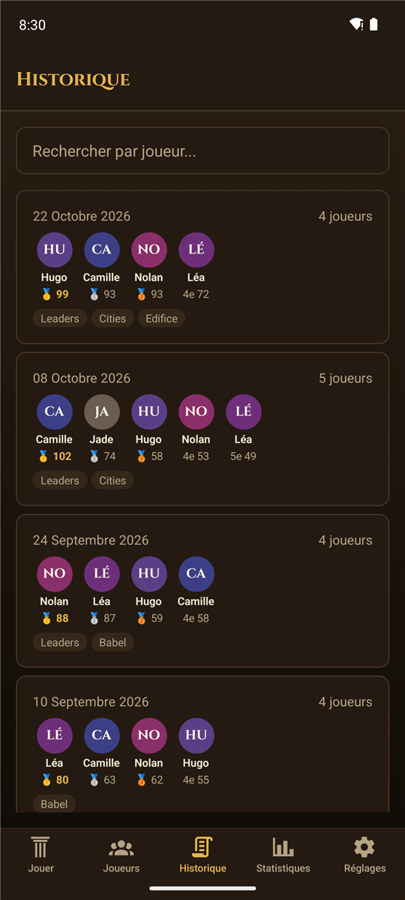
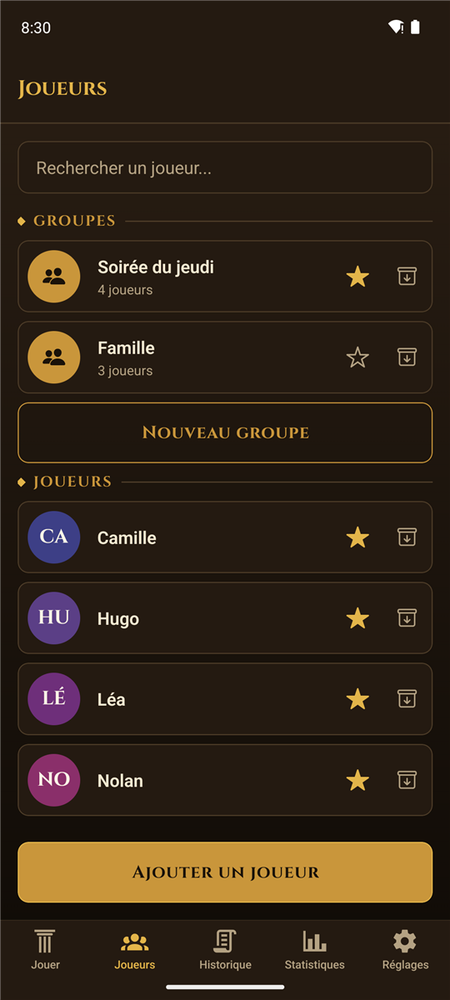

# 7 Wonders: Assistant

**L'appli qui compte les points de 7 Wonders à ta place, pendant que tu profites de la partie.**

[**📥 Télécharger l'APK**](https://github.com/Forthtilliath/7wonders-assistant/releases/latest)

---

Fini les additions au dos de la feuille de score. **7 Wonders: Assistant** calcule pour toi les points les plus fastidieux — sciences, militaire, trésor — pendant que tu restes concentré sur ta partie. Ajoute tes joueurs une fois, et l'appli se souvient de tout : favoris, historique, statistiques.

100% hors ligne, 100% sur ton téléphone : aucune donnée ne quitte l'appareil, sauf si tu actives la sauvegarde automatique sur ton propre Google Drive.

## 📱 En images

<table>
<tr>
<td width="33%"></td>
<td width="33%"></td>
<td width="33%"></td>
</tr>
<tr>
<td align="center">Lancer une partie</td>
<td align="center">Saisie des scores</td>
<td align="center">Résultats & classement</td>
</tr>
<tr>
<td width="33%"></td>
<td width="33%"></td>
<td width="33%"></td>
</tr>
<tr>
<td align="center">Statistiques</td>
<td align="center">Historique</td>
<td align="center">Joueurs & groupes</td>
</tr>
</table>

## ✨ Fonctionnalités

### Pendant la partie

- 🧮 **Calcul automatique des scores** — Sciences (optimisation des jokers comprise), Militaire et Trésor sont calculés à partir de ce que tu saisis, pas juste additionnés à la main.
- 🔢 **Compteur de jetons** — pour le militaire et le maritime, compte les jetons un par un plutôt que de calculer le total toi-même.
- 🃏 **Extensions** — Meneurs, Cités et Armada s'activent partie par partie, avec leurs propres catégories de score.
- 👥 **Joueurs & groupes** — profils avec avatar et favoris, groupes réutilisables pour lancer ta partie habituelle en un tap.

### Après la partie

- 🏆 **Résultats détaillés** — classement final et répartition des points par catégorie.
- 📤 **Partage** — le classement en texte (pour une messagerie), en image ou en CSV, depuis les résultats ou l'historique.
- 📜 **Historique** — chaque partie est enregistrée avec son classement et son détail.
- 📊 **Statistiques** — meilleur score, plus longue série de victoires, taux de victoire par joueur, points moyens par catégorie.

### Tes données

- ☁️ **Sauvegarde automatique sur Google Drive (optionnelle)** — une fois ton compte relié, tes données sont envoyées après chaque partie dans un dossier privé réservé à l'appli, et se restaurent sur un nouveau téléphone.
- 💾 **Export & import** — fichier de sauvegarde à garder où tu veux, chiffrement optionnel par mot de passe, annulation de la dernière restauration, export CSV pour ouvrir tes scores dans un tableur, et un rappel discret quand tes données n'ont pas été sauvegardées depuis un moment.
- 🔄 **Mises à jour intégrées** — *Réglages ▸ À propos* vérifie s'il existe une nouvelle version, la télécharge et lance l'installation.
- 🌗 **Thème clair / sombre**.

## 📥 Installation

L'appli est disponible pour **Android**, en dehors du Play Store.

1. Sur ton téléphone, ouvre la [dernière version](https://github.com/Forthtilliath/7wonders-assistant/releases/latest) et télécharge le fichier `.apk`.
2. Ouvre le fichier téléchargé. Si Android le demande, autorise ton navigateur (ou ton gestionnaire de fichiers) à **installer des applis inconnues**.
3. Lance **7 Wonders: Assistant**, ajoute tes joueurs, et c'est parti.

Les versions suivantes s'installent directement depuis l'appli : *Réglages ▸ À propos ▸ Vérifier les mises à jour*.

> [!IMPORTANT]
> **Tu as installé une des toutes premières versions ?** Les nouvelles versions sont signées avec une nouvelle clé, et Android refuse de les installer par-dessus l'ancienne. Avant de mettre à jour : fais une sauvegarde (Google Drive ou export dans *Réglages*), désinstalle l'appli, installe la nouvelle version, puis restaure ta sauvegarde.

## 🔒 Confidentialité

- **Aucun compte, aucun serveur, aucune publicité, aucun traceur.** Tes joueurs, parties et statistiques sont stockés uniquement sur ton téléphone.
- **Google Drive, seulement si tu le choisis.** L'appli n'a accès qu'à son propre dossier caché sur ton Drive : elle ne voit pas tes autres fichiers. Tu peux lui retirer cet accès à tout moment depuis les [autorisations de ton compte Google](https://myaccount.google.com/connections).
- **Connexion Internet utilisée pour** : la sauvegarde Google Drive (si activée) et la recherche de mises à jour sur GitHub. Rien d'autre.
- **Permission demandée** : l'installation d'applis, uniquement pour pouvoir installer les mises à jour que tu télécharges depuis l'appli.

## 🎯 Ce que l'appli calcule (et ce qu'elle ne calcule pas)

Toutes les catégories ne se saisissent pas de la même façon, et c'est voulu :

| Catégorie | Saisie |
| --- | --- |
| Sciences, Militaire, Trésor | **Calculées** à partir de ce que tu comptes sur ton plateau (symboles, jetons, pièces) |
| Civil, Commerce, Guildes, Merveille | **Total direct** : ils dépendent des cartes précises jouées, l'appli ne reproduit pas tout le jeu de cartes |
| Extensions Meneurs, Cités, Armada | Gérées, avec leurs catégories propres |
| Extensions Babel, Édifices | Non gérées |

## ☕ Soutenir le projet

Si l'appli te fait gagner du temps en soirée jeux, tu peux [m'offrir un café](https://buymeacoffee.com/forthtilliath). Un bug, une idée ? [Ouvre une issue](https://github.com/Forthtilliath/7wonders-assistant/issues).

## 🛠️ Contribuer

Installation du projet, architecture, configuration de Google Drive et publication d'une version : voir la [documentation développeur](./docs/README.md).

## 📄 Licence

Distribué sous licence [MIT](./LICENSE).
