

# 7 Wonders: Assistant

**L'appli qui compte les points de 7 Wonders à ta place, pendant que tu profites de la partie.**

[**📥 Télécharger l'APK**](https://github.com/Forthtilliath/7wonders-assistant/releases/latest)

---

Fini les additions au dos de la feuille de score. **7 Wonders: Assistant** te guide catégorie par catégorie, calcule les points les plus pénibles (sciences et leurs jokers, jetons militaires, tour de Babel) et additionne tout pendant que tu restes concentré sur ta partie. Ajoute tes joueurs une fois, et l'appli se souvient de tout : groupes, historique, statistiques.

100 % hors ligne, 100 % sur ton téléphone : aucune donnée ne quitte l'appareil, sauf si tu actives la sauvegarde automatique sur ton propre Google Drive.

> [!NOTE]
> Application non officielle, faite par un joueur pour les joueurs : il faut bien sûr le jeu *7 Wonders* pour jouer.

## 📑 Sommaire

- [En images](#-en-images)
- [Guide d'utilisation](#-guide-dutilisation)
  - [Premier lancement](#premier-lancement)
  - [Joueurs et groupes](#joueurs-et-groupes)
  - [Lancer une partie](#lancer-une-partie)
  - [Saisir les scores](#saisir-les-scores)
  - [Résultats et partage](#résultats-et-partage)
  - [Historique](#historique)
  - [Statistiques](#statistiques)
  - [Réglages](#réglages)
  - [Sauvegarde et changement de téléphone](#sauvegarde-et-changement-de-téléphone)
  - [Mises à jour](#mises-à-jour)
- [Ce que l'appli calcule](#-ce-que-lappli-calcule-et-ce-quelle-ne-calcule-pas)
- [Installation](#-installation)
- [Confidentialité](#-confidentialité)
- [Questions fréquentes](#-questions-fréquentes)
- [Soutenir le projet](#-soutenir-le-projet)

## 📱 En images

<table>
<tr>
<td width="33%"></td>
<td width="33%">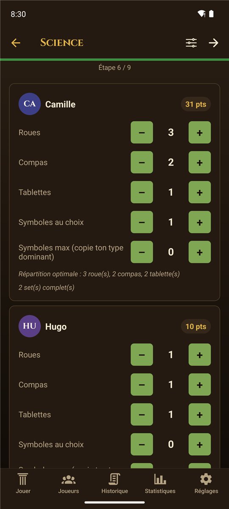</td>
<td width="33%"></td>
</tr>
<tr>
<td align="center">Lancer une partie</td>
<td align="center">Saisie des scores</td>
<td align="center">Résultats & classement</td>
</tr>
<tr>
<td width="33%"></td>
<td width="33%"></td>
<td width="33%">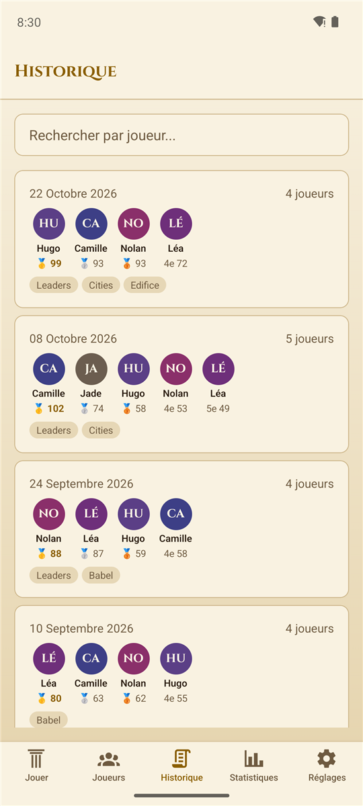</td>
</tr>
<tr>
<td align="center">Statistiques</td>
<td align="center">Historique</td>
<td align="center">Thème clair</td>
</tr>
</table>

## 📖 Guide d'utilisation

L'appli a cinq onglets, en bas de l'écran : **Jouer**, **Joueurs**, **Historique**, **Statistiques** et **Réglages**.

### Premier lancement

<table>
<tr>
<td width="33%">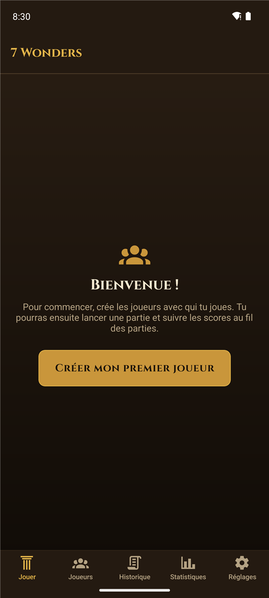</td>
<td>

Au premier lancement, l'appli te propose de **créer ton premier joueur**. Ajoute toutes les personnes avec qui tu joues : tu ne le feras qu'une fois.

Tu changes de téléphone et tu avais une sauvegarde ? Passe directement par *Réglages ▸ Gestion des sauvegardes* pour tout retrouver (voir [Sauvegarde](#sauvegarde-et-changement-de-téléphone)).

</td>
</tr>
</table>

### Joueurs et groupes

<table>
<tr>
<td width="33%"></td>
<td width="33%">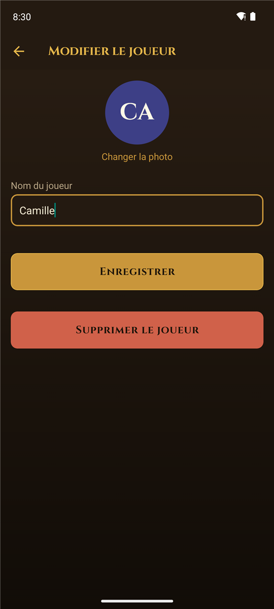</td>
<td width="33%">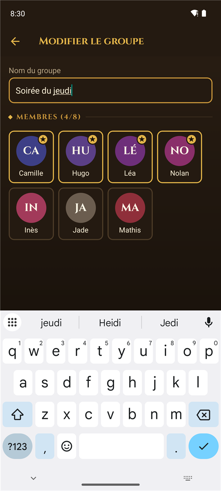</td>
</tr>
</table>

L'onglet **Joueurs** rassemble tes joueurs et tes groupes.

- **Joueur** : un nom et, si tu veux, une **photo** (prise sur le moment ou choisie dans la galerie), pratique pour distinguer deux joueurs aux initiales identiques. Sans photo, l'appli affiche les initiales sur une pastille de couleur.
- **Favori** (étoile) : le joueur ou le groupe passe en tête des listes.
- **Archiver** (boîte) plutôt que supprimer : un joueur qui ne vient plus disparaît de l'écran *Jouer*, mais ses parties et ses statistiques restent. Un deuxième appui le désarchive.
- **Groupe** : tes tablées habituelles (« Soirée du jeudi », « Famille »…) et leurs membres. Toucher un groupe dans l'onglet *Jouer* lance la partie avec eux en un geste.
- **Rechercher** : champ en haut de la liste ; toucher un joueur ou un groupe ouvre sa fiche.

Ajouter une photo

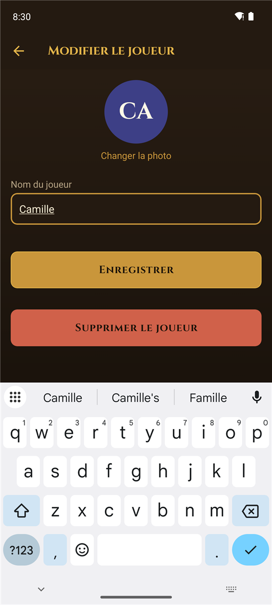

La photo est réduite et gardée dans l'appli ; elle voyage avec tes sauvegardes.

### Lancer une partie

<table>
<tr>
<td width="33%"></td>
<td width="33%">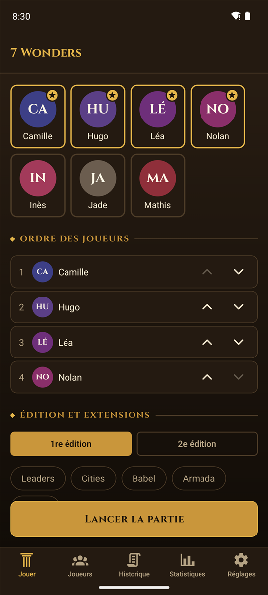</td>
<td>

Dans l'onglet **Jouer** :

1. **Joueurs** : touche chaque participant, ou touche un **groupe** pour lancer directement la partie avec tous ses membres.
2. **Ordre des joueurs** : flèches monter / descendre. C'est l'ordre suivi pendant la saisie : mets-le dans l'ordre de la table pour faire passer le téléphone.
3. **Édition et extensions** : 1re ou 2e édition, puis les extensions jouées. L'édition ne propose que les extensions compatibles (Babel n'existe qu'en 1re édition), et l'appli prévient si tu mélanges Babel et Edifice.
4. **Lancer la partie**.

L'édition et les extensions sont pré-cochées selon *Réglages ▸ Édition et extensions*.

</td>
</tr>
</table>

Une partie est déjà en cours ? L'onglet *Jouer* propose de la **reprendre** ou de l'**abandonner** (les scores déjà saisis sont alors perdus). Tu peux quitter l'appli en pleine partie : tout est gardé.

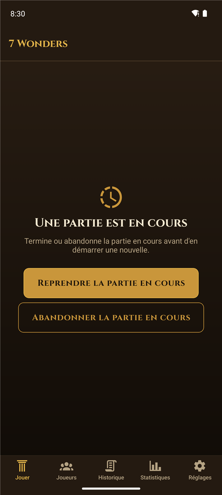

### Saisir les scores

La saisie se fait **catégorie par catégorie**, une étape à la fois (« Étape 3 / 9 »), avec tous les joueurs sur le même écran. La flèche en haut à droite passe à l'étape suivante, celle de gauche revient en arrière ; à la dernière étape, le trophée ouvre les résultats. Chaque nombre se règle avec **−** / **+** ou se tape directement.

<table>
<tr>
<td width="33%">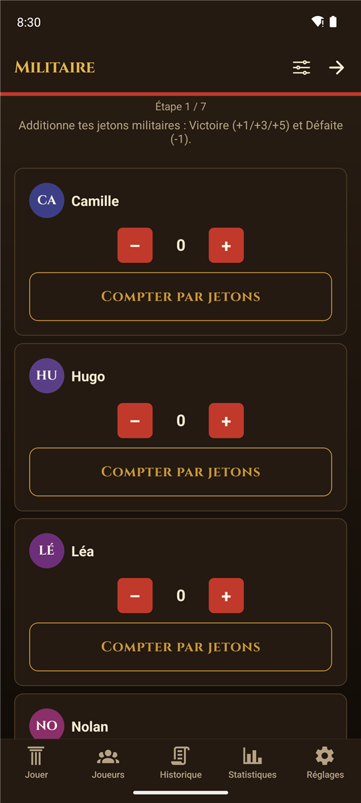</td>
<td width="33%">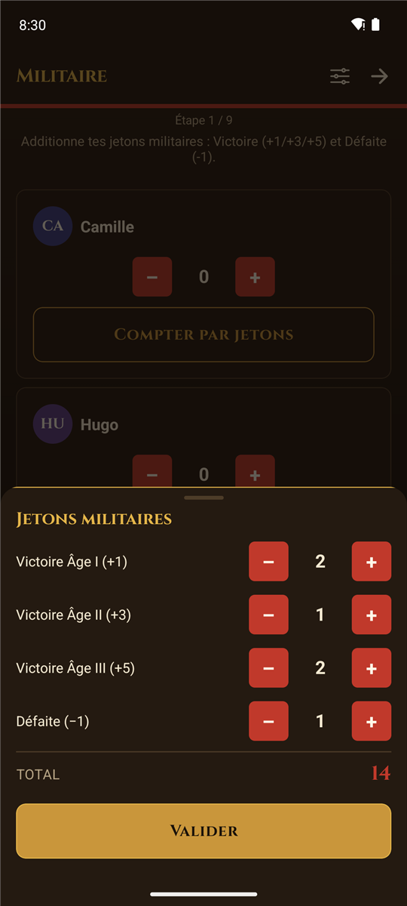</td>
<td width="33%"></td>
</tr>
<tr>
<td align="center">Militaire</td>
<td align="center">Compter par jetons</td>
<td align="center">Sciences</td>
</tr>
<tr>
<td width="33%">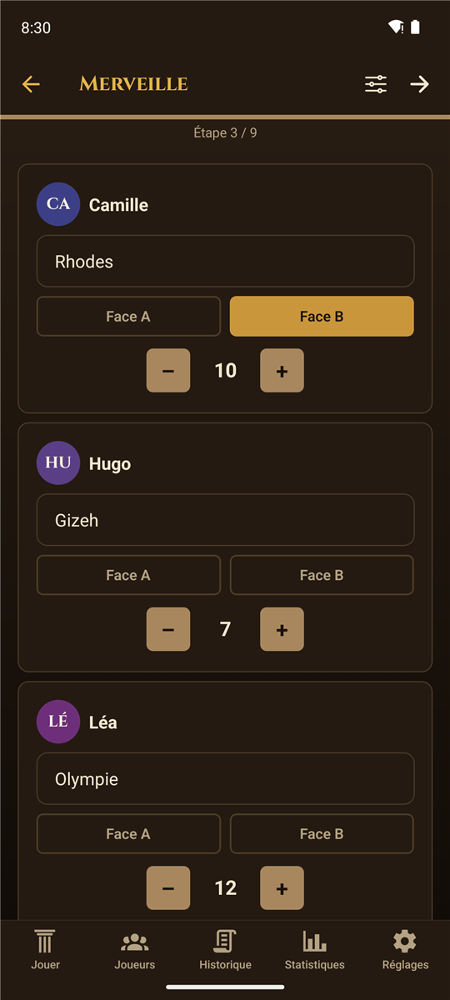</td>
<td width="33%">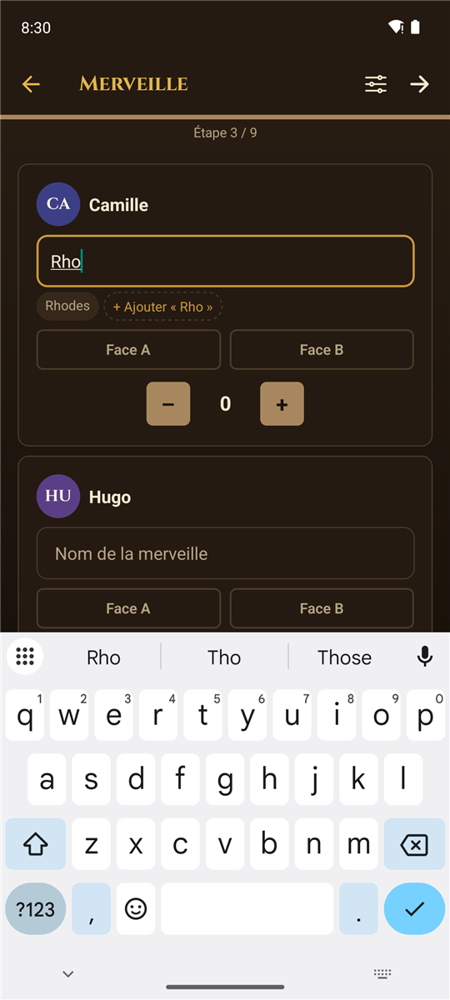</td>
<td width="33%">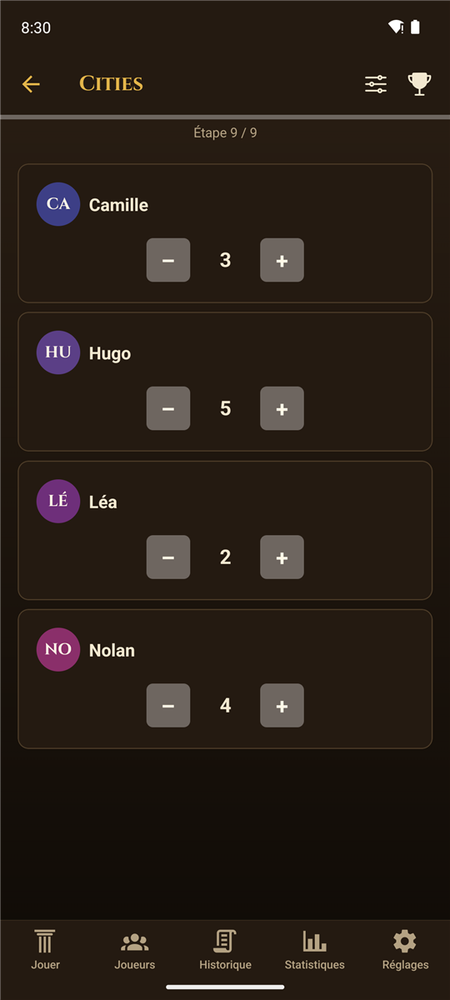</td>
</tr>
<tr>
<td align="center">Merveille</td>
<td align="center">Suggestions de merveilles</td>
<td align="center">Dernière étape</td>
</tr>
</table>

| Étape | Ce que tu saisis |
| --- | --- |
| **Militaire** | Le total de tes jetons de conflit. Ou **Compter par jetons** : combien de jetons de chaque sorte (Victoire +1 / +3 / +5, Défaite −1), l'appli fait le total. |
| **Trésor** | Tes pièces ÷ 3 (arrondi en dessous), moins tes éventuels jetons de dette (Cities). Avec Edifice, c'est aussi ici que comptent les pions Participation et les jetons Dette. |
| **Merveille** | Le nom de ta merveille (suggestions selon l'édition et les extensions, nom libre accepté), la face A ou B, et les points des étapes construites. |
| **Civil**, **Commerce**, **Guildes** | Le total des points de ces cartes. |
| **Sciences** | Le nombre de **roues**, **compas** et **tablettes**, les **symboles au choix** (jokers) et les **symboles max** (qui copient ton type dominant). L'appli place les jokers au mieux et calcule le score : le carré de chaque type, plus 7 points par série complète. |
| **Leaders**, **Cities** | Les points de l'extension, si elle est jouée. |
| **Babel** | Le nombre de tuiles posées sur la tour (0 à 3) : 0, 2, 5 ou 10 points. |
| **Maritime**, **Armada** | Avec Armada : tes jetons de conflit naval (comptables un par un), puis les points des Îles et de ton plateau Armada. |

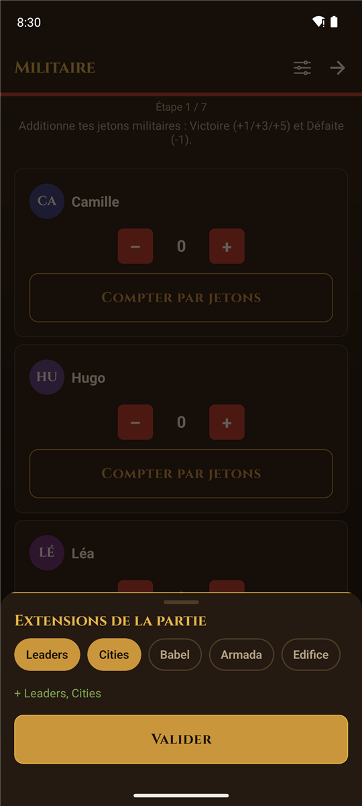

**Oublié une extension ?** Le bouton de réglages (en haut, à côté de la flèche) modifie les extensions **en cours de partie** : après confirmation, les étapes correspondantes s'ajoutent ou disparaissent.

 

### Résultats et partage

<table>
<tr>
<td width="33%"></td>
<td width="33%">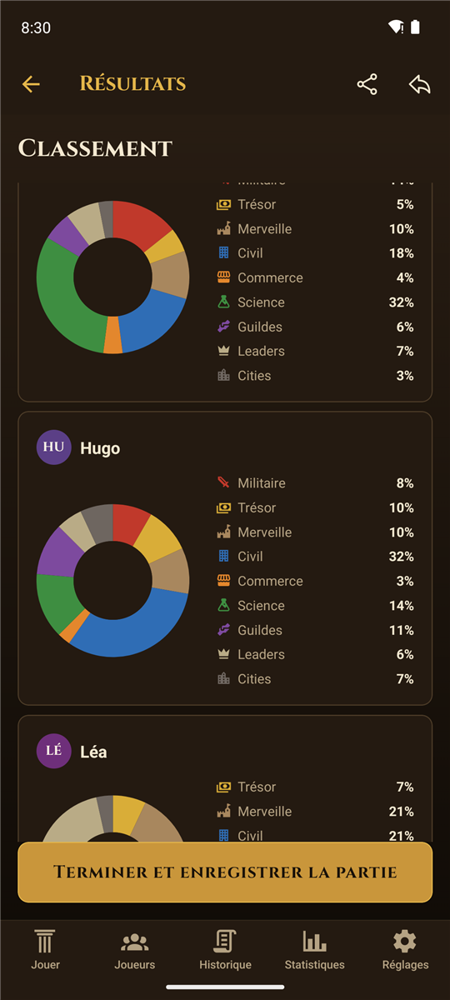</td>
<td width="33%">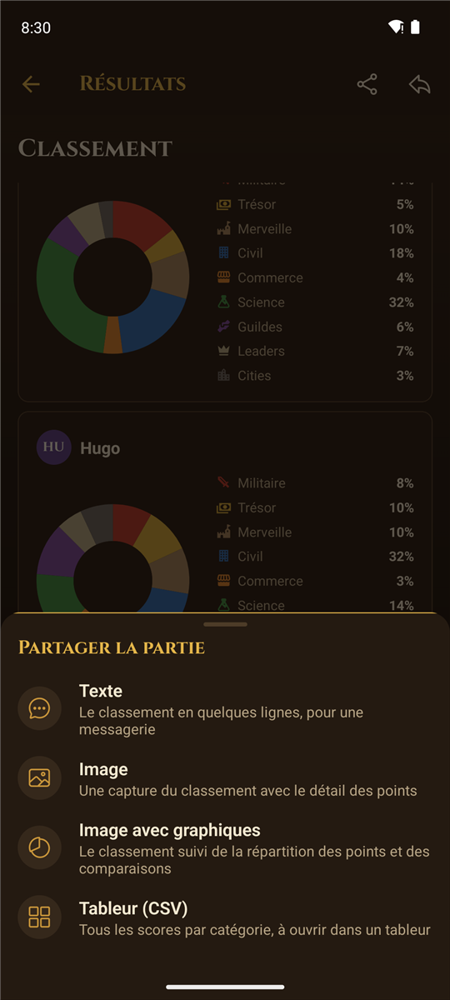</td>
</tr>
</table>

L'écran **Résultats** affiche le **classement** avec le détail de chaque catégorie, puis la **répartition des points** de chaque joueur (en anneau et en pourcentages).

- **Partager** (icône en haut) : en **texte** pour une messagerie, en **image** du classement, en **image avec graphiques** (classement, répartition et comparaisons), ou en **tableur (CSV)**.
- **Corriger la partie** (flèche en haut à droite) : revient à la saisie pour rectifier une erreur.
- **Terminer et enregistrer la partie** : la range dans l'historique et libère l'écran *Jouer*.

### Historique

<table>
<tr>
<td width="33%"></td>
<td width="33%">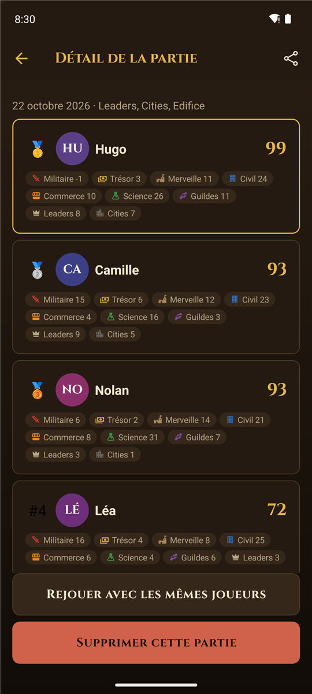</td>
<td>

L'onglet **Historique** liste toutes tes parties, de la plus récente à la plus ancienne : date, joueurs, podium, extensions.

- **Rechercher par joueur** : champ en haut.
- **Détail** : touche une partie pour revoir son classement et la répartition des points, la **partager** (mêmes formats que les résultats) ou la **supprimer**.

</td>
</tr>
</table>

### Statistiques

<table>
<tr>
<td width="33%"></td>
<td width="33%">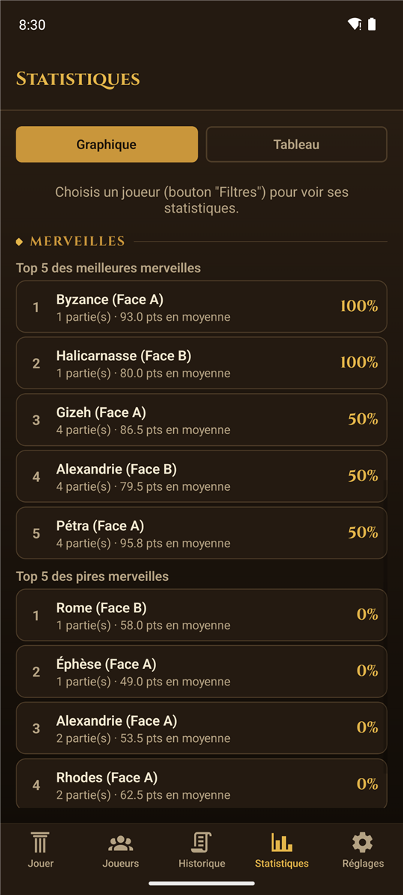</td>
<td width="33%">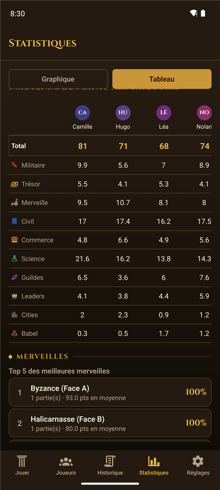</td>
</tr>
</table>

L'onglet **Statistiques** fait parler ton historique :

- **Records** : meilleur score, plus longue série de victoires, partie la plus disputée.
- **Taux de victoire** de chaque joueur (victoires / parties jouées).
- **Moyenne de points par catégorie**, joueur par joueur : en **graphique** ou en **tableau** (bascule en haut).
- **Merveilles** : les plus performantes, avec leur face, leur score moyen et leur taux de victoire.
- **Filtres** : ne compter que les parties jouées avec certaines extensions, et choisir un joueur pour voir ses statistiques à lui.

### Réglages

<table>
<tr>
<td width="33%">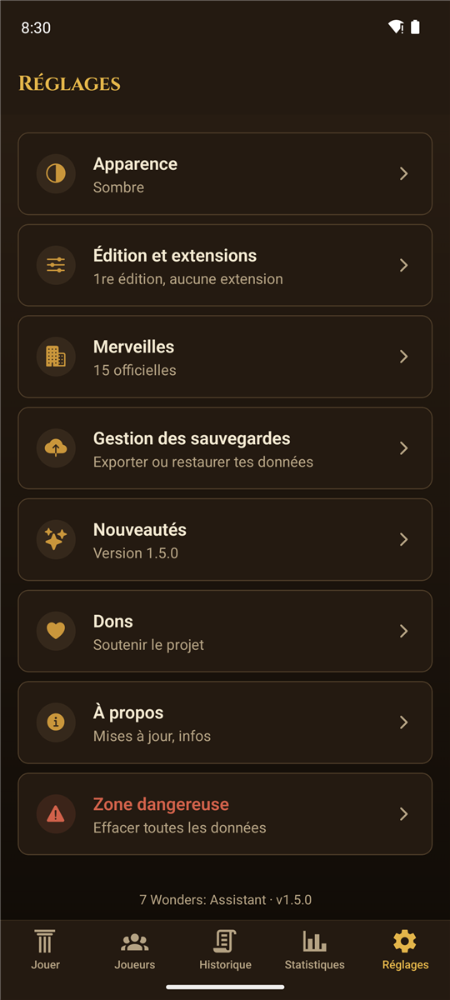</td>
<td width="33%">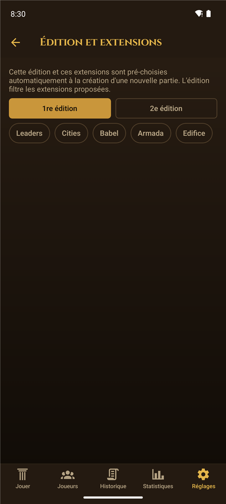</td>
<td width="33%">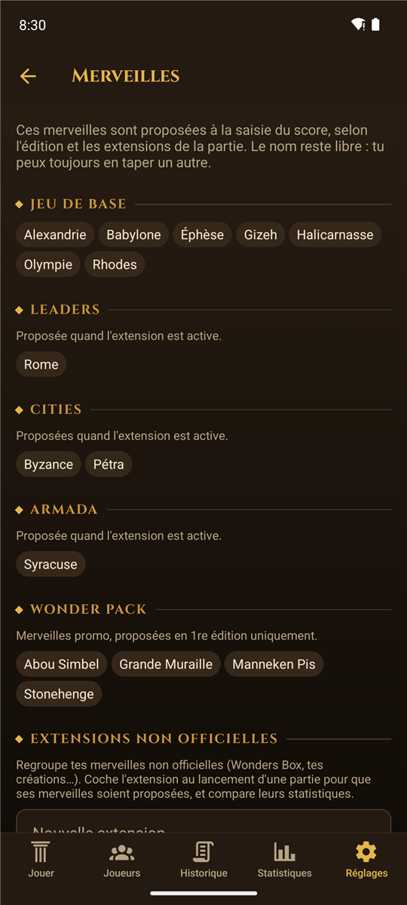</td>
</tr>
</table>

- **Apparence** : thème **sombre** (par défaut) ou **clair**.
- **Édition et extensions** : celles qui sont pré-cochées à chaque nouvelle partie.
- **Merveilles** : le catalogue proposé pendant la saisie, rangé par extension. Tu peux y **ajouter tes propres merveilles** et des **extensions non officielles** (promos, créations…), qui se cochent au lancement d'une partie comme les officielles.
- **Gestion des sauvegardes** : voir ci-dessous.
- **Nouveautés** : ce qui a changé à chaque version, et la recherche de mise à jour.
- **Dons** et **À propos**.
- **Zone dangereuse** : **effacer toutes les données** (joueurs, groupes, historique). Définitif : fais une sauvegarde avant.

Thème sombre et thème clair

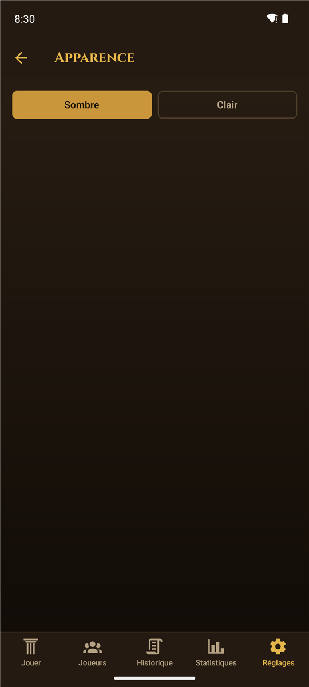 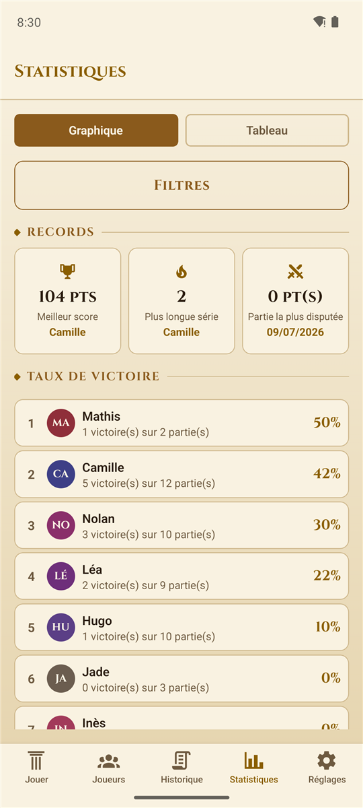

### Sauvegarde et changement de téléphone

<table>
<tr>
<td width="33%">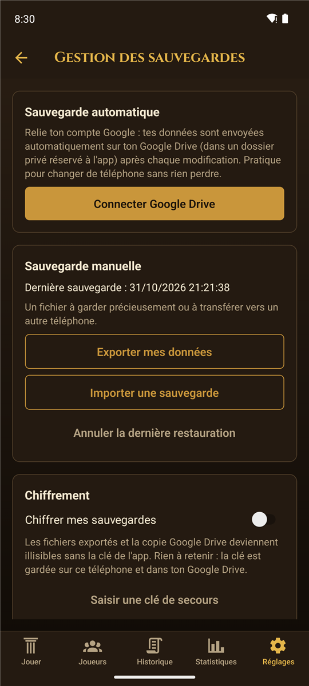</td>
<td>

*Réglages ▸ Gestion des sauvegardes* :

- **Sauvegarde automatique** : *Connecter Google Drive*. Tes données sont envoyées après chaque modification dans un **dossier privé** de ton Drive, réservé à l'appli (invisible dans tes fichiers). Sur un nouveau téléphone, reconnecte le même compte pour tout retrouver.
- **Sauvegarde manuelle** : *Exporter mes données* crée un fichier (joueurs et photos, groupes, parties, merveilles perso) à garder où tu veux. *Importer une sauvegarde* le restaure : **tout est remplacé**, après confirmation, et la restauration peut être **annulée** juste après.
- **Chiffrement** (facultatif) : *Chiffrer mes sauvegardes* rend fichiers et copie Drive illisibles sans la clé de l'appli. **Rien à retenir** : la clé est gardée sur le téléphone et dans ton Drive. Sans Drive, note la **clé de secours** affichée ; sur un nouveau téléphone, *Saisir une clé de secours* avant d'importer.
- **Scores en CSV** : tous tes scores dans un tableur.

Un **rappel discret** apparaît quand tes données n'ont pas été sauvegardées depuis un moment (*Sauvegarder* ou *Plus tard*). Un fichier abîmé ou modifié est refusé en entier, avec un message qui dit ce qui ne va pas : rien n'est importé à moitié.

</td>
</tr>
</table>

### Mises à jour

<table>
<tr>
<td width="33%">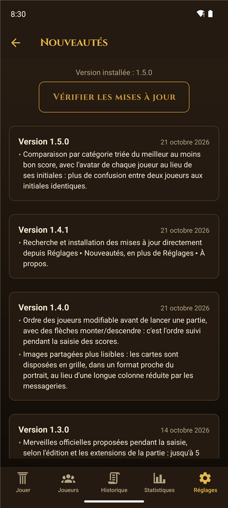</td>
<td width="33%">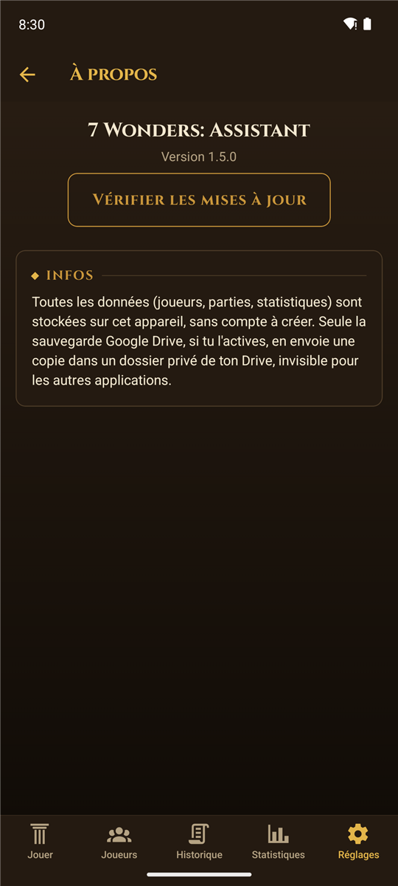</td>
<td>

*Réglages ▸ Nouveautés* ou *Réglages ▸ À propos* ▸ **Vérifier les mises à jour**. L'appli télécharge la nouvelle version, **vérifie son empreinte** (le fichier doit être identique à celui publié sur GitHub), puis Android te demande de confirmer l'installation. Android refuse de toute façon une mise à jour qui ne serait pas signée par l'auteur de l'appli.

</td>
</tr>
</table>

## 🎯 Ce que l'appli calcule (et ce qu'elle ne calcule pas)

Toutes les catégories ne se saisissent pas de la même façon, et c'est voulu :

| Catégorie | Saisie |
| --- | --- |
| **Sciences** | **Calculée** à partir de tes symboles, avec la meilleure répartition possible des jokers |
| **Militaire**, **Maritime** | Total direct, ou **calculé** à partir des jetons comptés un par un |
| **Babel** | **Calculée** à partir du nombre de tuiles posées |
| **Trésor**, Civil, Commerce, Guildes, Merveille, Leaders, Cities, Armada | **Total direct** : ils dépendent des cartes précises jouées, l'appli ne reproduit pas tout le jeu de cartes |
| **Edifice** | Pas de catégorie à part : se compte avec le trésor |

Le total de chaque joueur, le classement, les pourcentages et toutes les statistiques sont ensuite calculés pour toi.

## 📥 Installation

L'appli est disponible pour **Android**, en dehors du Play Store.

1. Sur ton téléphone, ouvre la [dernière version](https://github.com/Forthtilliath/7wonders-assistant/releases/latest) et télécharge le fichier `7WondersAssistant-<version>.apk`.
2. Ouvre le fichier téléchargé. Si Android le demande, autorise ton navigateur (ou ton gestionnaire de fichiers) à **installer des applis inconnues**.
3. Lance **7 Wonders: Assistant**, ajoute tes joueurs, et c'est parti.

Les versions suivantes s'installent directement depuis l'appli : *Réglages ▸ Nouveautés ▸ Vérifier les mises à jour*.

> [!IMPORTANT]
> **Tu as installé une des toutes premières versions ?** Les nouvelles versions sont signées avec une nouvelle clé, et Android refuse de les installer par-dessus l'ancienne. Avant de mettre à jour : fais une sauvegarde (Google Drive ou export dans *Réglages*), désinstalle l'appli, installe la nouvelle version, puis restaure ta sauvegarde.

## 🔒 Confidentialité

- **Aucun compte, aucun serveur, aucune publicité, aucun traceur.** Tes joueurs, parties et statistiques sont stockés uniquement sur ton téléphone.
- **Google Drive, seulement si tu le choisis.** L'appli n'a accès qu'à son propre dossier caché sur ton Drive : elle ne voit pas tes autres fichiers. Tu peux lui retirer cet accès à tout moment depuis les [autorisations de ton compte Google](https://myaccount.google.com/connections).
- **Connexion Internet utilisée pour** : la sauvegarde Google Drive (si activée) et la recherche de mises à jour sur GitHub. Rien d'autre.
- **Permissions** : l'installation d'applis, uniquement pour installer les mises à jour que tu télécharges depuis l'appli ; l'appareil photo, seulement quand tu prends la photo d'un joueur.
- La sauvegarde automatique d'Android est désactivée : tes données ne partent pas dans une copie que tu n'as pas choisie.

## ❓ Questions fréquentes

<b>Je me suis trompé dans une saisie.</b>

Pendant la partie, reviens à l'étape concernée avec la flèche de gauche. Sur l'écran des résultats, *Corriger la partie* rouvre la saisie. Une fois la partie enregistrée, elle n'est plus modifiable : supprime-la depuis l'historique si besoin.

<b>Mon téléphone s'est mis en veille / j'ai fermé l'appli en pleine partie.</b>

Rien n'est perdu : la partie en cours est enregistrée à chaque saisie. À la réouverture, l'onglet *Jouer* propose de la reprendre.

<b>Une merveille ou une extension manque.</b>

Le nom de la merveille est libre : tape-le simplement. Pour la retrouver dans les suggestions, ajoute-la dans *Réglages ▸ Merveilles*, éventuellement dans une extension non officielle à toi.

<b>Et si je change de téléphone ?</b>

Avec Google Drive, reconnecte le même compte sur le nouveau téléphone. Sinon, exporte un fichier de sauvegarde, copie-le sur le nouveau téléphone et importe-le (avec la clé de secours si tes sauvegardes sont chiffrées).

<b>Est-ce disponible sur iPhone ?</b>

Non, l'appli est développée uniquement pour Android.

## ☕ Soutenir le projet

Si l'appli te fait gagner du temps en soirée jeux, tu peux [m'offrir un café](https://buymeacoffee.com/forthtilliath). Un bug, une idée ? [Ouvre une issue](https://github.com/Forthtilliath/7wonders-assistant/issues).

## 🛠️ Contribuer

Installation du projet, architecture, calcul des scores, sauvegardes, configuration de Google Drive et publication d'une version : voir la [documentation développeur](./docs/README.md).

## 📄 Licence

Distribué sous licence [MIT](./LICENSE).
